<p align="center">
  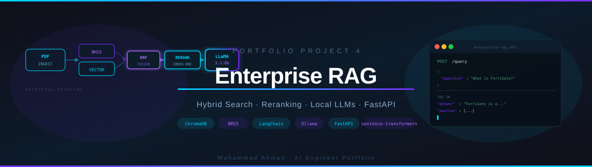
</p>

<p align="center">
  
  
  
  
  
  
</p>

<p align="center">
  <b>An enterprise-grade Retrieval-Augmented Generation system combining BM25 keyword search, vector similarity search, Reciprocal Rank Fusion, and cross-encoder reranking — all running 100% locally with no API keys required.</b>
</p>

---

## What Is This?

Most RAG systems use only vector search — which is great for semantic meaning but fails on exact terms like product codes, names, or technical jargon. This project solves that by implementing **hybrid search**: running both vector search and BM25 keyword search in parallel, fusing the results with **Reciprocal Rank Fusion (RRF)**, then reranking the top candidates with a **cross-encoder model** for maximum precision.

The entire pipeline runs locally using **Ollama** — no OpenAI, no API keys, no cloud costs.

---

## Architecture

```
┌─────────────────────────────────────────────────────────────────────┐
│                        INGESTION PIPELINE                           │
│                                                                     │
│   PDF Files  ──►  Chunking  ──►  Embeddings  ──►  ChromaDB         │
│                      │                                              │
│                      └──────────────────────►  BM25 Index          │
└─────────────────────────────────────────────────────────────────────┘

┌─────────────────────────────────────────────────────────────────────┐
│                        QUERY PIPELINE                               │
│                                                                     │
│   User Query                                                        │
│       │                                                             │
│       ├──► Vector Search (ChromaDB)  ──────────────┐               │
│       │                                             │               │
│       └──► Keyword Search (BM25)    ──────────────►│               │
│                                                     ▼               │
│                                          Reciprocal Rank Fusion     │
│                                                     │               │
│                                                     ▼               │
│                                          Cross-Encoder Reranking    │
│                                                     │               │
│                                                     ▼               │
│                                          LLaMA 3.1:8b (Ollama)     │
│                                                     │               │
│                                                     ▼               │
│                                          Answer + Sources           │
└─────────────────────────────────────────────────────────────────────┘
```

---

## Tech Stack

| Component | Technology | Purpose |
|---|---|---|
| **LLM** | `llama3.1:8b` via Ollama | Answer generation |
| **Embeddings** | `nomic-embed-text` via Ollama | Semantic vector embeddings |
| **Vector Store** | ChromaDB | Semantic similarity search |
| **Keyword Search** | `rank_bm25` (BM25Okapi) | Exact keyword matching |
| **Result Fusion** | Reciprocal Rank Fusion | Combines vector + keyword rankings |
| **Reranker** | `cross-encoder/ms-marco-MiniLM-L-6-v2` | Precision reranking of candidates |
| **PDF Parsing** | `pypdf` + LangChain loaders | Document ingestion |
| **API** | FastAPI + Uvicorn | REST API with Swagger UI |
| **Orchestration** | LangChain | Pipeline chaining |

---

## Screenshots

### 1. Project Structure
<p align="center">
  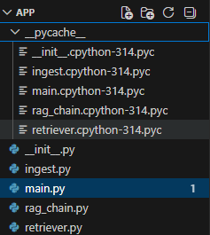
</p>

### 2. PDF Ingestion — 41 pages, 57 chunks indexed
<p align="center">
  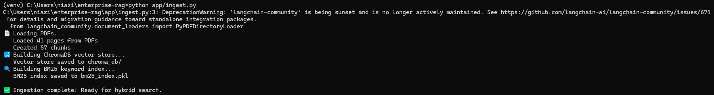
</p>

### 3. Ollama Models Pulled Locally
<p align="center">
  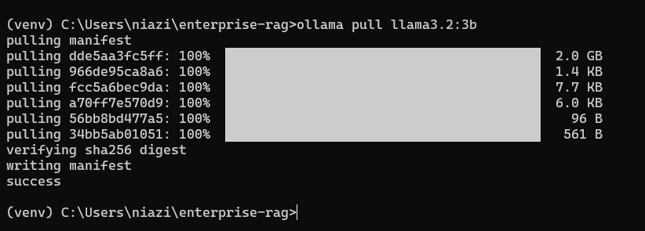
</p>

### 4. All Indexes Loaded Successfully
<p align="center">
  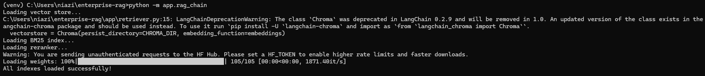
</p>

### 5. Hybrid Search in Action — Vector + BM25 + RRF + Reranking
<p align="center">
  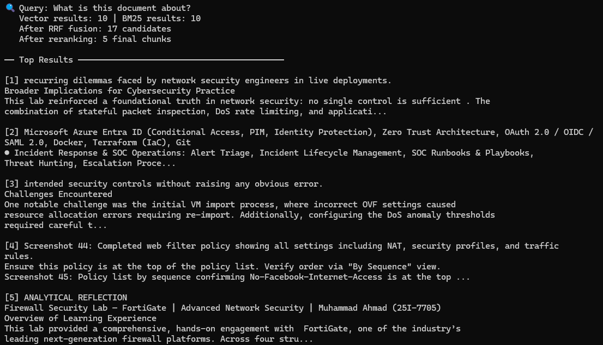
</p>

### 6. LLM Answer Generation from Retrieved Context
<p align="center">
  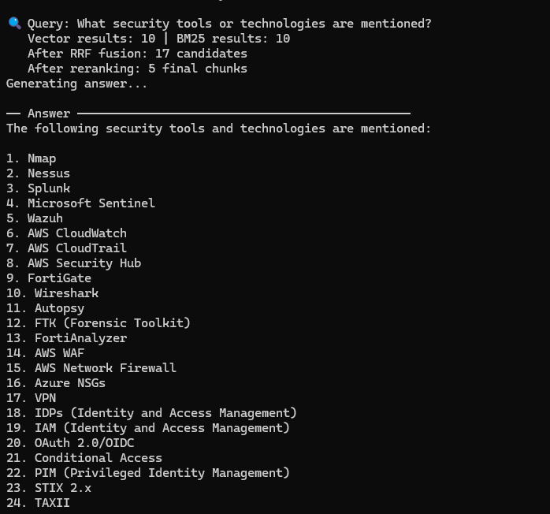
</p>

### 7. FastAPI Swagger UI — Interactive API Docs
<p align="center">
  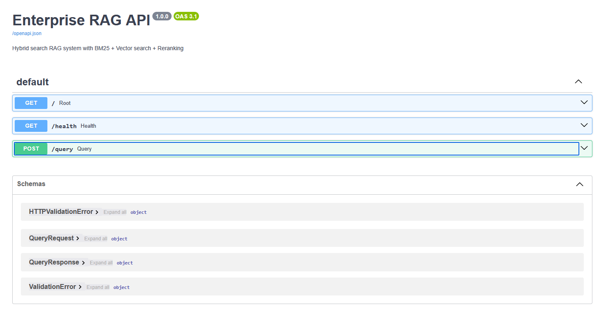
</p>

### 8. Live API Query
<p align="center">
  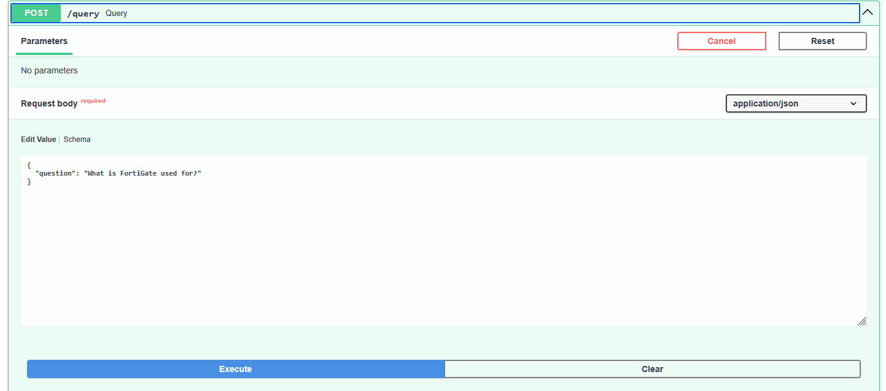
</p>

### 9. API Response — Answer + Sources (200 OK)
<p align="center">
  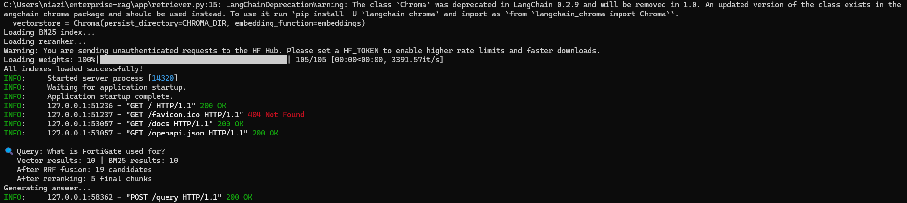
</p>

### 10. Full Answer from RAG Pipeline
<p align="center">
  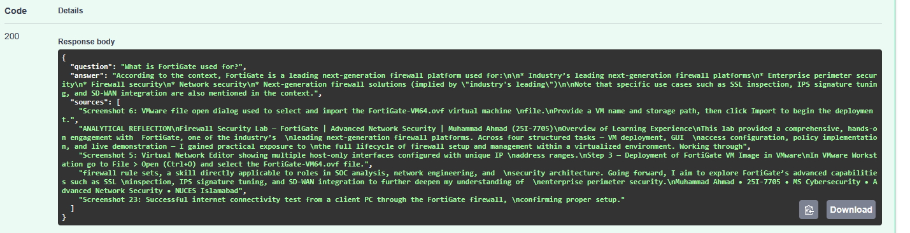
</p>

---

## Project Structure

```
enterprise-rag/
│
├── app/
│   ├── __init__.py
│   ├── ingest.py          # PDF loading, chunking, ChromaDB + BM25 indexing
│   ├── retriever.py       # Hybrid search: vector + BM25 + RRF + reranking
│   ├── rag_chain.py       # LLM prompt building and answer generation
│   └── main.py            # FastAPI REST API
│
├── data/                  # Place your PDF files here
├── screenshots/           # Project demo screenshots
├── assets/                # Banner and visual assets
│   └── banner.svg
│
├── requirements.txt
├── .gitignore
└── README.md
```

---

## How It Works

### Why Hybrid Search?

| Search Type | Strength | Weakness |
|---|---|---|
| **Vector Search** | Finds semantically similar content | Misses exact keyword matches |
| **BM25 Keyword** | Finds exact terms, codes, names | Misses semantic meaning |
| **Hybrid (RRF)** | Best of both worlds | — |

### Reciprocal Rank Fusion (RRF)

RRF combines two ranked lists into one without needing to normalize different score scales:

```
RRF_score(doc) = Σ 1 / (k + rank_in_list)
```

Where `k=60` is a constant that dampens the influence of high ranks. Documents appearing in both lists get a double boost.

### Cross-Encoder Reranking

Unlike embeddings (which encode query and document separately), a cross-encoder sees both together, making it significantly more accurate at judging true relevance. The top 20 fused candidates are passed through `ms-marco-MiniLM-L-6-v2` and only the top 5 are sent to the LLM.

---

## Setup & Installation

### Prerequisites

- Python 3.10+
- [Ollama](https://ollama.ai) installed and running

### 1. Clone the repository

```bash
git clone https://github.com/YOUR_USERNAME/enterprise-rag.git
cd enterprise-rag
```

### 2. Create virtual environment

```bash
python -m venv venv
# Windows
venv\Scripts\activate
# Mac/Linux
source venv/bin/activate
```

### 3. Install dependencies

```bash
pip install -r requirements.txt
```

### 4. Pull Ollama models

```bash
ollama pull llama3.1:8b
ollama pull nomic-embed-text
```

### 5. Add your PDF files

Place any PDF documents inside the `data/` folder.

### 6. Run ingestion

```bash
python app/ingest.py
```

This creates `chroma_db/` (vector store) and `bm25_index.pkl` (keyword index).

### 7. Start the API

```bash
uvicorn app.main:app --reload
```

---

## API Usage

### Interactive Docs

Visit `http://127.0.0.1:8000/docs` for the full Swagger UI.

### Endpoints

| Method | Endpoint | Description |
|---|---|---|
| `GET` | `/` | API info and available endpoints |
| `GET` | `/health` | Health check |
| `POST` | `/query` | Ask a question about your documents |

### Example Request

```bash
curl -X POST "http://127.0.0.1:8000/query" \
     -H "Content-Type: application/json" \
     -d '{"question": "What security tools are mentioned?"}'
```

### Example Response

```json
{
  "question": "What security tools are mentioned?",
  "answer": "The following security tools are mentioned: Nmap, Nessus, Splunk, Microsoft Sentinel, FortiGate, Wireshark, AWS CloudWatch...",
  "sources": [
    "Security, Vulnerability Assessment, TCP/IP...",
    "Firewall Security Lab — FortiGate..."
  ]
}
```

---

## Key Concepts Demonstrated

- **Document ingestion pipeline** — PDF loading, text splitting, metadata preservation
- **Dual indexing** — simultaneous vector (ChromaDB) and keyword (BM25) indexes
- **Reciprocal Rank Fusion** — score normalization-free result merging
- **Cross-encoder reranking** — query-aware relevance scoring
- **Local LLM inference** — fully offline with Ollama, no API costs
- **Context-grounded generation** — LLM answers strictly from retrieved context
- **Production API design** — REST endpoints with FastAPI and Pydantic validation

---

## Part of My AI Engineer Portfolio

This is **Project 4** in my structured AI/ML engineering portfolio roadmap:

| # | Project | Status |
|---|---|---|
| 1 | LLM Latency Benchmarker | ✅ Completed |
| 2 | Non-technical AI Dashboard | ✅ Completed |
| 3 | GGUF Quantization Comparator | ✅ Completed |
| **4** | **Enterprise RAG with Hybrid Search** | ✅ **Completed** |
| 5 | AI Coding Assistant with MCP + RAG + Tools | 🔜 Upcoming |
| 6 | AI Agent with MCP and Tools | 🔜 Upcoming |
| 7 | Production SaaS AI System | 🔜 Upcoming |

---

## License

MIT License — free to use, modify, and distribute.

---

<p align="center">
  Made by <b>Muhammad Ahmad</b> · AI Engineer
  <br/>
  <a href="https://github.com/YOUR_USERNAME">GitHub</a>
</p>
